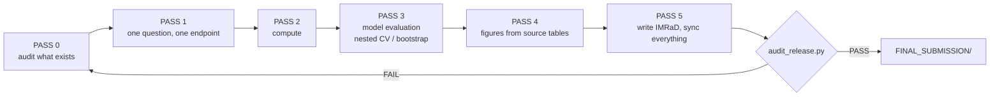

# bioinformatics-sci-master

An Agent Skill (SKILL.md format, Codex-compatible) for carrying a computational biology project from raw data to a submission-ready SCI manuscript. Install it, invoke `$bioinformatics-sci-master`, and it runs the project against a fixed set of evidence rules instead of whatever order the model happens to pick.

It was built around one observation: papers that get rejected usually don't lack algorithms — they lack a question chain. XGBoost runs first, then someone goes looking for the biology afterwards. This skill does the reverse: every analysis has to answer the question left open by the previous one, and every number in the manuscript has to trace back to a table, a script, and a sample denominator.

## Files

```
SKILL.md                                  execution rules, six-pass protocol
references/
  01-study-design-and-evidence.md         endpoints, cohorts, evidence tiers
  02-methods-and-algorithms.md            method selection and what each can't prove
  03-figures-and-design.md                publication layout rules
  04-scientific-writing-and-review.md     manuscript style and review passes
  05-release-and-quality-gates.md         release auditing, truthful status reporting
  06-smc56-p1-profile.md                  SMC5/6 pan-cancer project (8 main + 4 suppl. figures)
  07-verified-sources.md                  source papers, living standards
  08-figure-panel-library.md              117 candidate figure panels
scripts/
  init_project.py                         project scaffolding
  audit_release.py                        technical release audit
templates/                                ledgers, figure budget, execution prompt
agents/openai.yaml                        Codex interface metadata
```

## What it enforces

- No invented data of any kind — no patients, p-values, AUCs, DEGs or cell annotations. Every quantitative claim resolves to a source table, a script, and a sample denominator.
- Leakage control: outcome-informed selection, preprocessing and tuning stay inside training folds; external cohorts stay untouched until the model is locked.
- Evidence levels are labeled and never mixed. A CellChat edge is not a knockout. A drug-screen hit is not a therapeutic recommendation.
- Writing follows results: tables → analyses → panels → legends → Results → Discussion → Abstract → title.
- Statuses are honest. PARTIAL is reported as PARTIAL, and a scaffolded project is not a finished analysis.

## The pipeline



The decision rule behind every new analysis:

```
Question -> necessary input -> experimental/statistical unit -> comparison & confounders
-> method -> quantitative estimand -> independent validation -> figure
-> evidence classification -> manuscript claim
```

If a link is missing, the claim is dropped or downgraded rather than decorated.

## Install

```bash
# from source
git clone https://github.com/mingeric/bioinformatics-sci-master \
  ~/.agents/skills/bioinformatics-sci-master

# or grab the zip from Releases and unzip into ~/.agents/skills/
```

## Use

In a Codex session:

```
$bioinformatics-sci-master

Execute an evidence-first SCI bioinformatics paper.
Audit existing data and figures, run supported analyses,
generate publication-grade PNGs, and synchronize the
manuscript, methods, legends and evidence tables.

Validate the canonical release. Never invent results.
```

`templates/CODEX_EXECUTION_PROMPT.md` has a longer version for pasting into a specific repository.

## The audit tool

`audit_release.py` checks one canonical release: manifest and evidence CSV schemas, PNG signature and chunk CRCs, SHA256 against the manifest, no network and no nonstandard dependencies. It is a file-integrity gate, nothing more — it will happily pass a statistically wrong but well-formed release. Reviewing the statistics and biology stays with you.

Tested so far: an empty project fails the gate, a 12-PNG release passes. That validates the tool, not any biology.

## Data sources referenced

TARGET, GDC/TCGA, GEO, ICGC, GTEx, HPA, CPTAC, ProteomeXchange, DepMap, GDSC, PRISM/CTRP, LINCS/CMap. Single-cell: Seurat/Scanpy, donor-level pseudobulk. Perturbation tools (scTenifoldKnk, CellOracle, Geneformer) are treated strictly as hypothesis generation, not validated knockouts.

## License

MIT.
